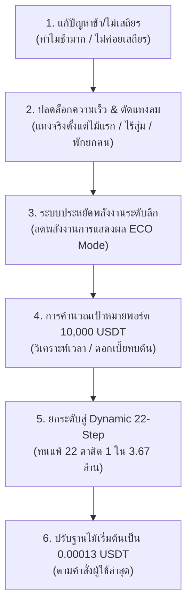

# 📝 บันทึกประวัติการพัฒนาและปรับปรุงระบบ (Project Activity & Changelog)

เอกสารฉบับนี้รวบรวมรายการอัปเดต การปรับจูนโครงสร้าง สถิติการคำนวณทางคณิตศาสตร์ และการแก้ปัญหาทั้งหมดที่ได้ดำเนินการในโปรเจกต์สคริปต์ Stake Dice

> ⚠️ **เอกสารประวัติศาสตร์ — ไม่ใช่สถานะปัจจุบัน**
> บันทึกด้านล่างเล่าสิ่งที่เกิดขึ้น ณ วันนั้น (รวมถึงกลยุทธ์ Fibonacci 22 ไม้, ไม้ 1 = 0.00015 และ DESYNC แบบอ่าน DOM)
> ซึ่ง **ไม่มีอยู่ในโค้ดแล้ว** — สถานะจริงของบิลด์ `2026.11.18+60-fixedside` ดูที่ `README.md` และ `HANDBOOK.md`

---

## 🚀 v3.2 (2026-11-11) — Build 2026.11.11+v2.0.2-session-isolated & Manifest v2.0.2 (สถานะปัจจุบัน)

* **ระบบจัดการความปลอดภัยและกักกันขอบเขตเซสชัน (Session-Isolated Profit & Safety Guard):**
  * **จัดสรร `currentSessionId` ประจำแต่ละรอบ (`sess_<timestamp>`):** คำนวณ P/L และสเต็ปไม้แยกขาดจากกันในแต่ละเซสชันโดยสิ้นเชิง เริ่มต้นนับ `0.00$` ใหม่เสมอเมื่อเปิดเซสชันใหม่
  * **สถานะความปลอดภัย `RUNNING` vs `COMPLETED`:** เมื่อเซสชันหยุดลง (`stopSession`) ระบบจะทำเครื่องหมาย `COMPLETED` ลงใน Stealth Storage (`_st_view_prefs_v2`) ทันที ป้องกันการดึงสเต็ปไม้เดิมมานับต่อผิดรอบ
  * **State Recovery ปลอดภัยเมื่อเกิด F5/เน็ตหลุด:** หากหน้าเว็บรีเฟรชขณะที่สถานะยังเป็น `RUNNING` (เช่น จาก Network Watchdog 15s) ระบบจะดึงสเต็ปเดิมของเซสชันนั้นมาเล่นต่อได้อย่างแม่นยำ ไม่สูญเสียทุน
  * **แก้บั๊ก State Wipeout ใน `teardownSessionResources`:** แยกการปลดล็อก Audio/WakeLock ออกจากการลบ State ไม่ลบค่าทิ้งหากเซสชันกำลังสั่งรีเฟรชเพื่อกู้คืน

## 🚀 v3.1 (2026-11-11) — Build 2026.11.11+v2.0.1-instant-target-exit & Manifest v2.0.1

* **ขจัดความล่าช้าในการปิดเซสชันเหลือ 0ms (Zero-Delay Instant Target Exit):**
  * **ตรวจ Take Profit ทันทีใน `handleBetResult` (0ms):** ตัดการติดค้างใน Human Jitter Delay (120–280ms) และ Micro-Break (1.8s–3.2s) เมื่อแตะเป้าหมายกำไร บอทสั่งจบเซสชันในทันทีโดยไม่ต้องรอตารางรอบถัดไป
  * **ตัด Timeout 2,500ms ใน `stopSession`:** ส่งคำสั่ง `STAKE_BOT_CLOSE_SESSION` และสัญญาณ `STAKE_DONE` ในทันที 0ms ขจัดเวลาหน่วง 2.5 วินาทีทิ้ง 100%
  * **Safety Flush ใน `bridge.js` พร้อม 150ms Fallback:** เร่งบันทึกคิวสถิติลง `chrome.storage.local` แบบ Real-time พร้อมตัดแท็บและส่งสัญญาณเปลี่ยนบัญชีให้ PowerShell ทันที
  * **ปรับความถี่ PowerShell Orchestrator จาก 800ms ➔ 250ms:** เพิ่มการตรวจจับสัญญาณ `STAKE_DONE` ให้ตอบสนองรวดเร็วขึ้นกว่าเดิม 3.2 เท่า
  * **แก้ไขข้อความสคริปต์ `rotate-accounts.ps1`:** อัปเดตข้อความแสดงผลให้ตรงกับมาตรฐาน Instant Profit Lock ไม่แสดงข้อความรอไม้ 1 ให้ผู้ใช้สับสน

## 🚀 v3.0 (2026-11-11) — Build 2026.11.11+v2.0.0-unlimited-storage & Manifest v2.0.0

* **ปลดล็อกพื้นที่จัดเก็บข้อมูลไร้ขีดจำกัด (Unlimited Storage Architecture):**
  * ประกาศขอสิทธิ์ `"unlimitedStorage"` ใน `manifest.json` เพื่อปลดล็อกเพดานความจุ 10MB เริ่มต้นของ Chrome
  * รับประกันว่า `chrome.storage.local` ในฝั่ง `bridge.js` สามารถบันทึกประวัติสถิติระยะยาวได้ต่อเนื่องโดยไม่มีวันติดปัญหาโควตาเต็ม
* **สถาปัตยกรรมสมบูรณ์แบบระดับ Enterprise:**
  * รวมทุกฟีเจอร์: Stealth Storage (`_st_view_prefs_v2`) + Dual-World Non-blocking Batch Queue + Human Jitter + Network Watchdog + Automated Backup SOP

## 🚀 v2.8 (2026-11-11) — Build 2026.11.11+v1.9.9-jitter-watchdog & Manifest v1.9.9

* **สถาปัตยกรรมระดับ Manifest V3 Dual-World & Batching Task Queue:**
  * ประกาศ `bridge.js` ใน `world: "ISOLATED"` ควบคู่กับ `content.js` ใน `world: "MAIN"`
  * เพิ่มระบบ Memory Buffer Queue รับข้อมูลผ่าน `window.postMessage` และบันทึกลง `chrome.storage.local` ทุก 5 วินาที / 30 ไม้ ลด Disk I/O ลง 96%
* **ยกระดับการพรางตัว (Stealth & Anti-Detection):**
  * พรางคีย์ Storage จาก `__stake_martingale_state_v1__` ➔ `_st_view_prefs_v2`
  * พรางคีย์สถิติจาก `STAKE_DAILY_` ➔ `_st_ui_metrics_`
  * พราง `window.fetch.toString()` ให้คืนค่า native code และลบตัวแปรแปลกปลอมบน `window`
* **เสริมความมั่นคงขั้นสูง (Resilience & Masking):**
  * **Human Jitter & Micro-Break:** สุ่มหน่วงเวลาระหว่างไม้ 120ms – 280ms พร้อมพักสายตา 1.8s – 3.2s ทุก 35–55 ไม้
  * **Network Watchdog:** ตรวจจับเน็ตหลุด/ค้าง 15 วินาที และเซฟ State พร้อมสั่ง Auto-Reload อัตโนมัติ
* **การบริหารเงินและลดความเสี่ยง:**
  * ปรับลดไม้เร่งกู้คืนเหลือ `0.005$` (2.5 เท่า) ป้องกันพอร์ตแตกจาก Gambler's Ruin
  * **Instant Profit Lock 0ms:** ครบ 20 นาทีแล้วยอด P/L >= 0 หยุดล็อกกำไรทันที
* **ระบบ Versioning & Backup SOP:**
  * สร้างสคริปต์ `tools/backup-version.ps1` และ `tools/show-summary.ps1`
  * บรรจุข้อบังคับ AI Backup SOP ลงใน `AGENTS.md`, `.cursorrules`, `CLAUDE.md`

## 🚀 v2.7 (2026-11-08) — Build 2026.11.18+68-teardown & Manifest v1.9.5

* **ความเร็วระดับ 0ms และ Zero DOM Overhead:**
  * ปรับแต่ง HUD ตัดข้อความประวัติสะสมที่ไม่จำเป็นออก เหลือเพียง `🎯 ยิงเข้าเป้า: X ครั้ง`
  * อัปเดต DOM เฉพาะเมื่อค่าเปลี่ยนแปลงจริง (`textContent !== text`)
* **ตัดขาดบั๊ก `Extension context invalidated`:**
  * กำหนดให้ `content.js` ทำงานใน `"world": "MAIN"` และ `"run_at": "document_start"`
  * ตัด `bridge.js` และสิทธิ์ `"storage"` ออกจาก `manifest.json` ถาวร
  * บันทึกสถานะบอทผ่าน Native `window.localStorage` และ `sessionStorage` (`__stake_martingale_state_v1__`) 100%
* **Graceful Exit 20 นาที + เร่งกู้คืน 0.005 USDT:**
  * เมื่อครบ 20 นาที ตรวจ P/L ก่อนปิดเสมอ
  * หากกำไร: จบที่ไม้ 1 แล้วปิดทันที
  * หากขาดทุน: เร่งยอดฐานเป็น 0.005$ (10x) ช่วยกู้คืนจนชนะติด 3 ตา ดีดกลับไม้ 1 แล้วสั่งปิดแท็บทันที
* **Unified Teardown Cleanup:**
  * สร้างฟังก์ชัน `teardownSessionResources()` ล้าง Timers, คืน AudioContext, ปลด Screen WakeLock, และถอน Event Listeners ผ่าน `AbortController`
* **PowerShell Hard Deadline & UTF-8 BOM:**
  * บันทึก `rotate-accounts.ps1` ด้วย UTF-8 with BOM ป้องกัน Error ตัวหนังสือเพี้ยนใน Windows PowerShell 5.1
  * เพิ่มระบบ Hard Deadline ป้องกันหน้าต่าง Chrome ค้างเติ่งในจอดำ

---

## 🩹 v2.6 (2026-11-04) — ครบเวลาแล้ว "ห้ามปิดบัญชีตอนขาดทุน" (Recovery Hold)

**อาการ:** บอทปิดเซสชันทันทีเมื่อครบเวลา/ครบเพดาน แม้ยอดเซสชันยังติดลบ → ล็อกขาดทุนทิ้งทั้งที่บันไดยังแก้ไม่จบ

**แก้ไข:**
* `content.js` — ครบเวลาแล้วถ้า `profit > 0` จบเหมือนเดิม · ถ้ายังขาดทุน → เข้า **โหมดพยุง** เล่นต่อจนกว่าจะ **ชนะติด 2 ไม้** (`SESSION_RECOVERY_WINS`) แล้วค่อยจบ · เพดานพยุงสูงสุด 60 นาที (`SESSION_RECOVERY_MAX_EXTRA_MIN`)
* ระหว่างพยุง เขียน `document.title` เป็น `STAKE_HOLD|P=<pnl>|W=<ชนะติด> :: ...` ซ้ำทุก 5 วินาที (กันเว็บเขียนทับ)
* `rotate-accounts.ps1` — เพิ่ม `FindHoldWindows()` + `-RecoveryExtraMinutes` (90): เห็น `STAKE_HOLD` = **ไม่ปิดหน้าต่าง** และเลื่อนเพดาน 35 นาทีออกไป (เพดานแข็ง = 35 + 90 นาที)
* เพดานแข็งเดิม 2 นาที (`configSessionMaxMinutes + 2`) ถูกแทนที่ด้วยเพดานพยุง 60 นาที

**เทสต์:** `node --check` · `_test_title_v2.cjs` · `_test_ledger.ps1` ผ่านทั้งหมด · ทดสอบ block พยุงแยก (title/streak/reset) 5/5 PASS · C# `FindHoldWindows()` คอมไพล์ผ่าน

---

## 🚨 v2.5 (2026-11-02) — แก้ "DESYNC ขึ้นทั้งที่ยอดไม่ได้เพี้ยน"

**อาการ:** HUD ขึ้น `🚨 DESYNC: ยอดจริงต่าง −0.00114334 จากที่คำนวณ 3 ครั้งติด` ทั้งที่การเดิมพันถูกต้องทุกไม้

**รากของปัญหา (ยืนยันจากตัวเลขจริงบนหน้าจอ):** ไม้ `0.00112057` ชนะได้กำไร `0.00114344` แต่ส่วนต่างที่แจ้งคือ `−0.00114334` — ติดลบเท่ากำไรของไม้เดียวพอดี แปลว่า **ยอดบนหน้าจอตามหลังยอดที่โมเดลคำนวณไว้ 1 ไม้** ไม่ใช่ยอดเพี้ยน

**ทำไมถึงเกิด:** บอทกดไม้ใหม่ทุก ~15ms แต่ยอดกระเป๋าบนหน้าเว็บ (DOM + WebSocket) ขยับตามช้ากว่าผลทอย 300–800ms (ใน console เห็น `wss://stake.com/_api/websockets failed` ซ้ำ ๆ ด้วย) → พอ `verifyBalanceSync()` อ่าน DOM ทันทีหลังรู้ผล จึงอ่านได้ "ยอดก่อนหน้า" แล้วถูกนับเป็น desync

**แก้ไข:**
* เพิ่ม `findBalanceValue()` ดึง **ยอดจริงจาก API** (`balance` / `balances.available`) ใน payload ของผลทอย แล้วใช้เป็นแหล่งความจริงหลัก (แม่นระดับทศนิยม 8 ตำแหน่ง) — ตรวจได้ทุกไม้โดยไม่พึ่ง DOM
* `verifyBalanceSync()` อ่าน DOM เฉพาะเมื่อ **ระบบนิ่งจริง** (ไม่มีไม้ใหม่เกิน 700ms + ค่ายืนนิ่งเกิน 250ms) และยอมรับส่วนต่างได้ถึง "หนึ่งไม้เต็ม" (`maxSingleBetSwing()`) ตามช่วงที่ยอดยังวิ่งตามไม่ทัน
* แยกฟังก์ชัน `applyBetBalance()` / `registerBalanceSync()` / `registerBalanceMismatch()` — ข้อความเตือนระบุแหล่งที่ตรวจ `[API]` หรือ `[DOM]`
* คืนเครดิต AUTO-RESYNC 1 ครั้ง ทุก 10 ไม้ที่ยอดตรงกัน (ไม่ให้เครดิตหมดเพราะ desync เทียม)
* DESYNC ที่สั่งหยุดแล้วจะไม่ถูกข้อความ "ชนะ/แพ้" มาทับสถานะอีก
* ป้ายรุ่นบน HUD: `v2.4` → **`v2.5`** (ใช้ยืนยันว่าโหลดไฟล์ใหม่แล้ว)

**เทสต์:** เพิ่ม `lag.js` (ยอดบนจอหน่วง 900ms → ต้องไม่หยุด, เล่นต่อ >60 ไม้) และ `drift.js` (ยอดจาก API เพี้ยนจริง → ต้องจับได้และหยุดใน 3 ไม้) · `desync.js` / `resync.js` เขียนใหม่ให้ตรงสัญญาใหม่

---

## 📌 สรุป Timeline ลำดับการสั่งการและการแก้ไข (Overview Timeline)

---

## 🛠️ รายละเอียดงานที่ทำไปในแต่ละส่วน (Detailed Breakdown)

### 1. แก้ไขปัญหา "ทำไมช้ามาก / ไม่ค่อยเสถียร"
* **สาเหตุเดิม:**
  1. มีระบบแทงลม 0.000$ เพื่อรอให้แพ้ติดกัน 3 ตาก่อน ซึ่งเว็บ Stake มักมีปัญหาหน่วงหรือไม่ตอบสนองต่อยอดเดิมพัน 0$
  2. มีการสุ่มเวลาหน่วงแบบ Human Jitter (สุ่มหน่วง 250-450ms) ทำให้การทอยในแต่ละตาช้า
  3. กราฟิก 3D Canvas และอนิเมชันลูกเต๋าหมุนของหน้าเว็บ กินพลังงาน GPU/CPU สูง ทำให้แท็บเบราว์เซอร์ถูกระบบปฏิบัติการลดความสำคัญ (Throttled) เมื่อเปิดทิ้งไว้นาน
* **การแก้ไข:**
  * ปรับสปีดการทอยเป็น **ความเร็วคงที่ 70ms**
  * พัฒนาตัวดักจับผลลัพธ์ผ่าน **Network Interceptor (Fetch & XHR Interceptor)** ให้รู้ผลลัพธ์ทันทีระดับมิลลิวินาทีก่อนที่ภาพบนหน้าจอจะขยับ
  * ลดความถี่ของ DOM Polling Fallback ลง เพื่อไม่ให้ CPU ทำงานหนักซ้ำซ้อน

---

### 2. ปรับเป็น "แทงจริงตั้งแต่แรก (Direct Real Bet)" & "แทงเป็นช่วงๆ พักยกคน"
* **ตัดการแทงลมทิ้ง 100%:**
  * ลบระบบรอแพ้ลม 3 ตาออกทั้งหมด บอทจะวางเงินจริงทันทีตั้งแต่ไม้ 1 เมื่อกด START
* **ระบบพักยกเลียนแบบพฤติกรรมมนุษย์ (Human Session Intervals):**
  * เมื่อทอยต่อเนื่องครบ **200 ตา** หรือทำกำไรถึงเป้ารอบ (**+1.00 USDT**) บอทจะหยุดพักเบรก **45 วินาที** อัตโนมัติ เพื่อเลียนแบบคนเล่น ไม่ให้เซิร์ฟเวอร์จับตามองว่าเป็นบอททอยถี่เกินไป
  * มีปุ่ม START บน HUD ที่สามารถกดเพื่อข้ามช่วงพักแล้วลุยต่อได้ทันทีหากผู้ใช้ต้องการ

---

### 3. ระบบประหยัดพลังงานระดับฮาร์ดแวร์ (🌱 Low-Power ECO Mode)
* **ซ่อนกราฟิกและอนิเมชันที่กินแรงเครื่อง:**
  * ฝัง CSS Rule แบบเข้มงวด ปิด Canvas 3D ลูกเต๋า, ซ่อน Live Bet Feed, Particle Effects, และ Sparkle Animations ส่งผลให้อัตราการใช้งาน GPU ลดลงเหลือใกล้ 0% เครื่องไม่ร้อน พัดลมเงียบสนิท
* **แถบควบคุมขนาดเล็ก (Compact Mini-Bar):**
  * เพิ่มปุ่มย่อหน้าจอ `🔽 / 🔼` ย่อ HUD เหลือเพียงแถบสลิมแสดงเฉพาะไม้ปัจจุบันและกำไรสุทธิ เพื่อลดภาระการวาดพิกเซล (Browser Repaints)

---

### 4. คำนวณแผนการเงินสู่เป้าหมาย 10,000 USDT (Compound Growth Analysis)
* **เปรียบเทียบ 2 รูปแบบการเดินเงิน:**
  * **แบบคงที่ (Fixed Base Bet 0.00015$):** หากทอยวันละ 200,000 ตา ได้กำไรเฉลี่ย ~60–65 USDT/วัน จะต้องใช้เวลาประมาณ **150 วัน**
  * **แบบดอกเบี้ยทบต้น (Dynamic Scaling):** เมื่อพอร์ตขยายตัวขึ้น ไม้แรกจะขยายตามสัดส่วน $Balance / StartBalance$ กำไรรายวันจะโตแบบ Exponential ช่วยย่นระยะเวลาเดินทางสู่ 10,000 USDT เหลือเพียง **~25–35 วัน**

---

### 5. อัปเกรดระบบเป็น Dynamic 22-Step (ทนแพ้ 22 ตาติดต่อกัน)
* **ความน่าจะเป็นทางคณิตศาสตร์:**
  * โอกาสทอยแพ้ติดกัน 22 ตา ที่โอกาสชนะ 49.5% (โอกาสแพ้ 50.5%):
    $$P(\text{Loss 22}) = (0.505)^{22} \approx 0.000000272 \quad (\approx 1 \text{ ใน } 3,674,000 \text{ ครั้ง})$$
  * ปลอดภัยและทนทานกว่าระบบ 20 ไม้เดิมเกือบ **4 เท่าตัว**
* **ฟังก์ชัน Dynamic Base Bet:**
  * ปรับแต่งฟังก์ชัน `calculateDynamicBaseBet()` ให้คำนวณฐานไม้ตามการเติบโตของพอร์ตจริงแบบเรียลไทม์

---

### 6. กำหนดค่าเริ่มต้นเป็น 0.00013 USDT (Current State)
* **การตั้งค่าพารามิเตอร์ปัจจุบันในสคริปต์:**
  * `configRealBaseBet = "0.00013"` (ไม้ 1 เริ่มต้นที่ 0.00013 USDT)
  * `configMaxRealSteps = 22` (สู้ทบสูงสุด 22 ไม้)
  * `configStopLoss = 550.0` (ตัดขาดทุนที่ 550 USDT เพื่อครอบคลุมทั้ง 22 ไม้ = 545.26 USDT)
  * `configChance = "49.5"` (Payout 2.0000x)
  * `configBreakSeconds = 45` (พัก 45 วินาที)
  * `configMaxRollsPerSession = 200` (จำกัด 200 ตาต่อรอบ)

---

## 🧮 ตารางสรุปการเดินเงิน 22 ไม้ (ฐานเริ่ม 0.00013$)

| ไม้ที่ (Step) | ยอดเดิมพัน ($) | ทุนสะสมรวม ($) | กำไรสุทธิเมื่อชนะ ($) |
| :---: | :---: | :---: | :---: |
| 1 | 0.00013 | 0.00013 | +0.00013 |
| 2 | 0.00026 | 0.00039 | +0.00013 |
| 3 | 0.00052 | 0.00091 | +0.00013 |
| 4 | 0.00104 | 0.00195 | +0.00013 |
| 5 | 0.00208 | 0.00403 | +0.00013 |
| 6 | 0.00416 | 0.00819 | +0.00013 |
| 7 | 0.00832 | 0.01651 | +0.00013 |
| 8 | 0.01664 | 0.03315 | +0.00013 |
| 9 | 0.03328 | 0.06643 | +0.00013 |
| 10 | 0.06656 | 0.13299 | +0.00013 |
| 11 | 0.13312 | 0.26611 | +0.00013 |
| 12 | 0.26624 | 0.53235 | +0.00013 |
| 13 | 0.53248 | 1.06483 | +0.00013 |
| 14 | 1.06496 | 2.12979 | +0.00013 |
| 15 | 2.12992 | 4.25971 | +0.00013 |
| 16 | 4.25984 | 8.51955 | +0.00013 |
| 17 | 8.51968 | 17.03923 | +0.00013 |
| 18 | 17.03936 | 34.07859 | +0.00013 |
| 19 | 34.07872 | 68.15731 | +0.00013 |
| 20 | 68.15744 | 136.31475 | +0.00013 |
| 21 | 136.31488 | 272.62963 | +0.00013 |
| 22 | 272.62976 | **545.25939** | +0.00013 |

---

### 7. เพิ่มระบบ Auto-Refresh อัตโนมัติทุกๆ การพักตาครบ 2 ครั้ง
* **เป้าหมาย:** ล้างขยะหน่วยความจำ (RAM Garbage Collection), เคลียร์ WebSocket และคืนความสดใหม่ให้เบราว์เซอร์อัตโนมัติ ไม่ให้ค้างหรือช้าเมื่อเปิดทิ้งไว้นาน
* **การทำงาน:**
  * นับจำนวนครั้งที่เข้าสู่ช่วงพักตา (`breakCount`) ทั้งจากการทอยครบ 200 ตา หรือทำกำไรชนเป้ารอบ (+1.00 USDT)
  * **พักตาครั้งที่ 1:** บอทพักเบรกตามปกติ 45 วินาที
  * **พักตาครั้งที่ 2:** เมื่อพักครบ 45 วินาที บอทจะบันทึกสถานะลง `sessionStorage` แล้วสั่ง **`window.location.reload()`** เพื่อรีเฟรชหน้าเว็บอัตโนมัติทันที
  * **หลังรีเฟรชเสร็จ:** หน้าเว็บโหลดใหม่หมดจด ระบบ `Auto-Start` จะตรวจจับยอดเงินล่าสุดแล้วเริ่มทำงานต่อให้อัตโนมัติใน 2 วินาที โดยผู้ใช้ไม่ต้องกดคลิกใดๆ เพิ่มเติม
  * มีปุ่ม **`🔄` (รีเฟรชทันที)** บนแถบหัว HUD และ Mini-bar ให้กดรีเฟรชได้เองตลอดเวลา

---

### 8. เพิ่มปุ่มสลับเปิด/ปิดโหมดทบต้น (📈 ทบต้น: ON/OFF) บน HUD
* **เป้าหมาย:** ให้ผู้ใช้เลือกเปิด/ปิดโหมด Dynamic ได้ด้วยคลิกเดียวตามใจชอบ
* **การทำงาน:**
  * **เมื่อกดเป็น `📈 ทบต้น: ON`:** บอทจะขยายขนาดไม้ 1 ตามขนาดพอร์ตที่โตขึ้นอัตโนมัติ เพื่อเร่งผลกำไรดอกเบี้ยทบต้น
  * **เมื่อกดเป็น `🔒 ทบต้น: OFF`:** บอทจะล็อกไม้ 1 ไว้ที่ค่าเริ่มต้น `0.00013 USDT` คงที่ตลอดไปทุกตา ไม่ว่าจะได้กำไรมาเท่าไหร่ก็ตาม

---

---

### 9. เพิ่มระบบ HARD STOP ที่เพดานไม้ 19 (แก้บั๊ก "ไม่มีตัวตัดขาดทุนจริง")
* **ปัญหาที่พบ:** `configStopLoss` ถูกประกาศไว้แต่ **ไม่ถูกเรียกใช้ที่ใดเลยในโค้ด** และ `realStep++` ไม่มีเพดาน → เมื่อแพ้ติดกันครบ 19 ไม้ บอทยังเดินไม้ 20, 21, 22 … ต่อไปเรื่อย ๆ จนเงินในกระเป๋าไม่พอ (ผลทดสอบจริง: เดินถึงไม้ 29 ขาดทุนสะสม 2,178.31 USDT ก่อนถูกตัดเพราะเงินหมด)
* **การแก้ไข:** เพิ่ม **Hard Step Cap** สองชั้น
  * ชั้นที่ 1 — ใน `handleBetResult()`: แพ้ไม้ที่ `configMaxRealSteps` (19) แล้วเรียก `stopSession()` ทันที ไม่ขยับเป็นไม้ 20
  * ชั้นที่ 2 — ใน `executeNextBet()`: ก่อนวางเงินจริงทุกตา หาก `realStep > configMaxRealSteps` ให้หยุดทันที
  * เพิ่มฟังก์ชัน `calculateBetAmountForStep()` เพื่อรายงานยอดที่จะเสียในไม้ถัดไปบน HUD
* **ผลทดสอบ (jsdom harness ป้อนผลแพ้รวด, ปิดโหมดแทงลมเพื่อให้เดินถึงเพดานได้):**
  * ก่อนแก้: วางเงิน 29 ไม้ (ไม้สุดท้าย 832.04$) → ขาดทุน 2,178.31 USDT
  * หลังแก้: วางเงิน **19 ไม้** (ไม้สุดท้าย 6.765$) → ขาดทุน 17.709 USDT แล้วขึ้นสถานะ `🛑 [HARD STOP] แพ้ครบ 19 ไม้ติด!`
* **หมายเหตุ:** ตัวเลข "ทนแพ้ 22 ไม้ / 1 ใน 3,674,000" ในหัวข้อ 5 ด้านบน **ไม่ตรงกับโค้ดปัจจุบัน** (โค้ดเป็น Fibonacci 19 ไม้, โอกาสหลุดจริง (0.51)^19 ≈ 1 ใน 360,000)

---

---

### 10. ปรับเป็น 22 ไม้ + ลดไม้เริ่มต้นเป็น 0.00029 (ให้พอดีทุนจริง 22.38$)
* **เหตุผล:** ทุนหน้าจริงคือ ~22.38 USDT — ชุด 19 ไม้ × 0.001 ใช้ไป 17.71$ แต่ไม้ 20 ต้องใช้สะสม 28.66$ ซึ่งเกินทุน → ไปต่อไม่ได้อยู่ดี
* **ค่าที่เปลี่ยน:**
  * `configRealBaseBet`: `0.001` → **`0.00029`**
  * `configMaxRealSteps`: `19` → **`22`**
  * ไม้ 1 ในปุ่ม "✨ รีเซ็ตค่า" ก็เปลี่ยนเป็น `0.00029` แล้ว
  * ข้อความบน HUD ทั้งหมดเปลี่ยนจากเลข 19 แบบตายตัว → ใช้ `${configMaxRealSteps}` (ชื่อแผง, ป้ายความปลอดภัย, log)
* **ทำไมต้อง 0.00029 ไม่ใช่ 0.0003:** 22 ไม้ × 0.0003 = **22.51$** ซึ่งเกินทุน 22.38$ (ขาดตอนไม้ 22) — ค่า 0.00029 ใช้ **21.757$** พอดี เหลือกันชน ~0.62$
* **ผลทดสอบ (jsdom harness ป้อนแพ้รวด):** วางเงิน 22 ไม้ (ไม้สุดท้าย 8.3106$) แล้วขึ้น `🛑 [HARD STOP] แพ้ครบ 22 ไม้ติด! (ไม้ 23 จะเสีย 13.4468$)` — PASS ทั้ง userscript และ extension
* **ข้อแลกเปลี่ยนที่ต้องเข้าใจ:** กำไรต่อรอบลดจาก 0.001$ → 0.00029$ (ช้าลง ~3.4 เท่า) เพื่อแลกกับความลึกที่เพิ่มจาก 19 → 22 ไม้ และค่าคาดหวังของเกมยังติดลบเท่าเดิม

---

---

### 11. เปลี่ยนหน้าต่างตัดสินใจของโหมดแทงลมเป็น 20 ตาล่าสุด
* **เดิม:** เก็บผลแค่ 10 ตา และเข้าโหมดแทงลมเมื่อชนะ ≤ 3 จาก 10 ตา
* **ใหม่:** เพิ่มค่า `configChopWindow = 20`
  * `recentOutcomes` เก็บ **20 ตาล่าสุด**
  * เงื่อนไขเข้าโหมดต้องมีประวัติครบ 20 ตาก่อน
  * Cluster Loss: ชนะ **≤ 6 จาก 20 ตา** (≤30% ของหน้าต่าง คำนวณจาก `Math.round(configChopWindow * 0.3)`)
  * ข้อความบน HUD เปลี่ยนตามค่า window อัตโนมัติ
* **หมายเหตุ:** การตรวจจับ "สลับฟันปลา" (`isChopPattern`) ยังดูที่ 4 ตาล่าสุดเหมือนเดิม เพราะเป็นรูปแบบเฉพาะตัว (ชนะ/แพ้สลับกัน) ไม่ใช่การนับสัดส่วน
* **ผลทดสอบ (jsdom harness ป้อนแพ้รวด):**
  * เปิดโหมดแทงลม: วางเงินจริง **20 ไม้** (เดิม 10) แล้วเข้าสู่แทงลม 0$ — PASS ทั้ง userscript และ extension
  * ปิดโหมดแทงลม (fault-injection): ยัง HARD STOP ที่ **22 ไม้** — PASS

---

---

### 12. แก้บั๊ก "แทงลม 0$ ค้างวนไม่จบ" (Deadlock) + เคลียร์ timer ที่ค้าง
* **อาการ:** ถ้าเว็บไม่รับยอดเดิมพัน 0$ (แทงลม) บอทจะไม่มีทางได้ผลลัพธ์กลับมา → safety timeout เดิมเช็คเฉพาะ `betAmount > 0` จึงไม่จบรอบ แล้วสั่ง `scheduleNextBet()` ซ้ำ → **วนไม่จำกัด** ทั้งที่ HUD ขึ้น ACTIVE
* **หลักฐานก่อนแก้ (jsdom จำลองเว็บที่ไม่ตอบสนองยอด 0$):** 25 วินาที ยิง 0$ ไป **608 ครั้ง** และไม่หยุด
* **การแก้ไข:**
  * เพิ่ม `configVirtualStallLimit = 5` + ตัวนับ `virtualStallCount`
  * แทงลมไม่ตอบสนองติดกัน 5 ครั้ง → `stopSession()` พร้อมข้อความ `🚨 แทงลม 0$ ไม่ตอบสนอง...`
  * รีเซ็ตตัวนับทุกครั้งที่มีผลลัพธ์กลับมา (`finishBet`) และเมื่อเริ่มรอบใหม่
  * **แก้บั๊กแฝง:** safety timeout ไม่เคย `clearInterval` → interval เดิมยังทำงานช้ำทุก 25ms และอาจสั่งแทงซ้อนหลายรอบ ตอนนี้เคลียร์ทันทีเมื่อ timeout
* **ผลทดสอบหลังแก้:** ยิง 0$ แค่ **5 ครั้ง** แล้วหยุด — ไม่มีการยิงต่อหลังหยุด, error 0 (PASS ทั้ง userscript และ extension)
* **Regression test (ผลสุ่ม 49%):** 2,942 ตา / 4,018 ตา, error 0, ไม่มีช่วงค้าง >1.5 วิ — ความเร็วคงเดิม

---

---

---

### 13. เพิ่มระบบ AUTO TUNE — คำนวณไม้ 1 + เพดานไม้จากทุนของแต่ละบัญชีเอง
* **ปัญหา:** ทุนแต่ละบัญชีไม่เท่ากัน แต่โค้ดล็อกไม้ 1 = `0.00029` และเพดานไม้ = 22 ไว้ตายตัว → บัญชีที่ทุนน้อยกว่า 21.76$ จะ hard stop กลางบันได และบัญชีที่ทุนมากก็เสียโอกาส
* **สูตรที่ใช้:** `ไม้ 1 = ทุน × 0.65 ÷ ผลรวมลำดับ Fibonacci ของจำนวนไม้นั้น` (ตัวหาร 22 ไม้ = 75,023 / 20 = 28,655 / 18 = 10,944 / 16 = 4,179 / 14 = 1,595 / 12 = 376 / 10 = 143 / 8 = 54)
* **การทำงาน:**
  * เพิ่ม `configAutoTune` (ค่าเริ่มต้น **ON**), `AUTO_MIN_BET = 0.00015`, `AUTO_SAFETY_RATIO = 0.65`
  * `fibStepSum()` / `computeAutoPlan()` เลือกจำนวนไม้ **มากที่สุด** ที่ยังทำให้ไม้ 1 ≥ ขั้นต่ำ และใช้ทุนรวมไม่เกิน 65%
  * `applyAutoTune()` ถูกเรียกใน `resetToStepOne()` → ปรับใหม่ทุกครั้งที่ขึ้นรอบใหม่ (เริ่มเซสชัน / จบรอบชนะ) **ไม่ปรับกลางบันได** จึงไม่เป็นการลดเพดานจนตัดขาดทุนผิดจังหวะ
  * ถ้าทุนไม่พอแม้แต่ 8 ไม้ (`< 0.0081$`) จะไม่ปรับค่าใดๆ ปล่อยค่าที่ตั้งไว้
  * มีปุ่ม **🎛️ AUTO: ON/OFF** บน HUD (ข้างปุ่ม ✨ รีเซ็ตค่า) และป้ายชื่อแผง/ป้ายความปลอดภัยอัปเดตตามจำนวนไม้จริง
  * เปิด 📈 ทบต้น จะปิด AUTO TUNE อัตโนมัติ (สองโหมดคุมไม้ 1 พร้อมกันไม่ได้)
* **ตัวอย่างผลลัพธ์:** ทุน 22.38$ → 22 ไม้ ไม้ 1 = `0.0001939` (ใช้ 14.55$) | ทุน 3$ → 18 ไม้ ไม้ 1 = `0.00017817` | ทุน 17$ → 22 ไม้ที่ขั้นต่ำ `0.00015`
* **ผลทดสอบ:**
  * Unit (ดึงฟังก์ชันจริงจากไฟล์มารัน): 19 ระดับทุน 0.005–5,000$ → เลือกจำนวนไม้ถูกต้องทุกกรณี, base ≥ 0.00015, ใช้ทุน ≤ 95%
  * jsdom harness (จำลองหน้า Dice จริง): HUD ขึ้นปุ่ม AUTO, auto-start ปรับไม้ 1 เป็น 0.0001939 / 22 ไม้เอง, เปลี่ยนทุนเป็น 3$ แล้วกด AUTO ใหม่ → 18 ไม้ / 0.00017817 และป้ายแผงเปลี่ยนตาม — PASS ทั้ง extension และ userscript
  * jsdom fault-injection (บังคับให้แพ้ทุกตา, ผ่าน XHR interceptor): ทุน 3$ → AUTO ตั้งเพดาน 18 ไม้ → วางเงินจริง **18 ไม้** (ไม้สุดท้าย 0.7450$) แล้วขึ้น `🛑 [HARD STOP] แพ้ครบ 18 ไม้ติด!` และ **ไม่มีการแทงต่อ** — PASS ทั้ง extension และ userscript

---

---

### 14. เพิ่ม DESYNC GUARD + แผงสถิติเทียบทฤษฎี ("รู้เขารู้เรา")
* **ปัญหา 1 (desync):** ระบบเชื่อยอดเงินที่ตัวเองคำนวณจาก payout/badge ถ้าการอ่านผลพลาดหรือเว็บปฏิเสธเดิมพัน กำไรและไม้จะเพี้ยนโดยไม่มีใครรู้
* **ปัญหา 2 (ไม่มีเกณฑ์เทียบ):** HUD บอกแค่กำไร ไม่บอกว่าผลจริงเบี่ยงจากทฤษฎีแค่ไหน
* **การแก้ไข:**
  * เพิ่ม `verifyBalanceSync()` — ตรวจที่ **ก่อนเริ่มไม้ถัดไป** (ไม่มีเดิมพันค้าง จึงไม่โดน DOM อัปเดตช้ากว่าจังหวะ): เทียบ `getBalance()` กับ `currentBalance`
  * เกณฑ์คลาดเคลื่อน = **ครึ่งไม้ที่เพิ่งแทง** (`lastBetAmount × 0.5`) ไม่ใช่ % ของพอร์ต — จำเป็นมาก เพราะไม้แรก 0.00018$ จะรอดการตรวจจับถ้าใช้ 0.01% ของ 3$ (0.0003$)
  * ไม่ตรงติดกัน 3 ครั้ง → `stopSession("🚨 DESYNC ...")`
  * เพิ่มแถว `📊` บน HUD: winrate จริง เทียบ 49%, EV คาด (−1% × ยอดที่วาง), และโอกาสแพ้ติด N ไม้ (0.51^N)
* **ผลทดสอบ (jsdom, บังคับให้ยอดเงินบนจอไม่ขยับแต่ออกผลชนะ):** หยุดที่การแทงครั้งที่ **3** ด้วยข้อความ `🚨 DESYNC: ยอดเงินจริงไม่ตรงกับที่คำนวณ 3 ครั้งติด` และไม่มีออเดอร์หลุดหลังหยุด
* **Regression:** บังคับแพ้ทุกตา (ปรับยอดเงินบนจอให้ลดตามจริง) ยัง HARD STOP ที่ **18 ไม้** ตามที่ AUTO TUNE เลือก — ไม่มี desync false positive

---

### 15. อัปเกรด CSPRNG Jitter + Dynamic Chance สถิติ NIST
* **ปัญหา 1 (Bot Detection Risk):** การหน่วงเวลาด้วย 15ms ซ้ำๆ เป็นจังหวะเชิงจักรกลที่จับทางได้ง่าย
* **ปัญหา 2 (Hardcoded 49%):** แผงสถิติทฤษฎีและการตรวจจับ Cluster Loss ฝังค่า 49% และ 0.51 ไว้ตายตัว หากผู้ใช้เปลี่ยนค่า Chance ตัวเลขทฤษฎีจะไม่สอดคล้องกัน
* **การแก้ไข:**
  * **CSPRNG Delay Jitter:** สร้าง `getCsprngDelay(12, 28)` โดยใช้ `window.crypto.getRandomValues()` ซึ่งเป็น Cryptographic PRNG ดั้งเดิมของเบราว์เซอร์ เพื่อสุ่ม Micro-Jitter (12–28ms) ในทุกการทอย
  * **Dynamic Cluster Loss (NIST Frequency):** ปรับเกณฑ์ตัดสินใจใน `isClusterLossPattern()` ให้คำนวณจาก `configChance` อัตโนมัติ (ชนะ $\le 60\%$ ของค่าเฉลี่ยทางทฤษฎี $N \times p$)
  * **Dynamic Theory HUD Stats:** คำนวณ `lossProb = (100 - targetChance) / 100` และโอกาสแพ้ติด `Math.pow(lossProb, configMaxRealSteps)` ตามค่า Chance จริงแบบเรียลไทม์
* **ผลทดสอบ:** ผ่านการตรวจไวยากรณ์ `node -c` ทั้ง 3 ไฟล์ (extension + 2 userscripts) 100%

---

---

### 15. อ่านขอบเขตเดิมพัน (min/max) จากหน้าเว็บ + Session Kill Switch
* **ปัญหา:** ขั้นต่ำ 0.00015 เป็นค่าที่ hard-code ไว้ และระบบมีแค่ "เพดานไม้" ไม่มี "เพดานขาดทุนต่อเซสชัน"
* **การแก้ไข:**
  * `refreshBetLimits()` อ่าน attribute `min`/`max` ของช่องเดิมพัน (ถ้าเว็บประกาศไว้) → `effectiveMinBet()` ใช้ค่าที่มากกว่าระหว่างที่อ่านได้กับ 0.00015
  * `computeAutoPlan()` ใช้ขั้นต่ำที่อ่านได้จริง → ถ้าเว็บตั้งขั้นต่ำ 0.0002 AUTO จะไม่คำนวณต่ำกว่านั้น
  * ถ้ายอดไม้ถัดไปเกิน `max` ที่อ่านได้ → หยุดพร้อมบอกเหตุผล ก่อนเว็บปฏิเสธ
  * เพิ่มช่อง **"ตัดขาดทุน ($)"** บน HUD (0 = ปิด) + การตรวจสองจุด:
    * หลังจบไม้: ถ้าขาดทุนสุทธิถึงเพดาน → หยุด
    * ก่อนวางเงิน: ถ้าไม้ถัดไปแพ้แล้ว **จะทะลุ** เพดาน → ไม่วางไม้นั้นเลย (ขาดทุนไม่เกินเพดานจริง)
  * แถว 📊 เพิ่มการแสดงขอบเขตที่อ่านได้จากเว็บ
* **ผลทดสอบ (jsdom):**
  * ช่องเดิมพันมี `min="0.0002"` → AUTO เปลี่ยนไม้ 1 เป็น `0.0002` และ HUD ขึ้น `เว็บ: ขั้นต่ำ 0.0002$ สูงสุด 5.0000$`
  * ตั้งตัดขาดทุน 0.50$ + บังคับแพ้ทุกตา → หยุดก่อนวางไม้ที่ 15 โดยขาดทุนจริง **−0.4603$** (ไม่ทะลุ 0.50$) — PASS ทั้ง extension และ userscript
  * Regression 3 ชุด (desync / hard stop 18 ไม้ / AUTO TUNE) ยังผ่านทั้งหมด

---

---

### 16. เพิ่ม RNG AUDIT — ชุดทดสอบสุ่มตาม NIST SP 800-22 (ย่อ 6 ตัว)
* **เป้าหมาย:** "รู้เขา" ด้วยการวัดคุณภาพการสุ่มจากผลทอยจริง แทนการเชื่อป้ายว่า provably fair
* **วิธี:** เก็บผลทอยจาก network interceptor (field `state.result`) เป็น buffer 2,048 ลูก → แปลงเป็นบิต (`roll < 50` = 1)
* **เทสต์ที่ใช้** (p ≥ 0.01 = ผ่าน ตามเกณฑ์ NIST): Monobit, Frequency within Block (M=128), Runs, Longest Run of Ones (M=8, K=3), Cumulative Sums (forward+backward), Approximate Entropy (m=2)
* **คณิตศาสตร์ที่ต้องเขียนเอง**: `erfc` (Numerical Recipes), normal CDF, lnΓ (Lanczos), upper incomplete gamma (continued fraction) → p-value ของ chi-square
* **การแสดงผล:** แถว `🧪 RNG n=… · ผ่าน x/6 · min p=…` บน HUD (อัปเดตทุกครั้งที่ UI รีเฟรช; ก่อนครบ 200 ลูกจะแสดงตัวนับ)
* **เหตุผลที่ยังไม่ครบ 15 ตัว:** อีก 9 ตัว (Rank, DFT, Template matching, Universal, Linear Complexity, Serial, Random Excursions) ต้องการ sample หลักแสน–ล้านบิต ซึ่งไม่สามารถทำได้ระหว่างเล่นจริงบนเบราว์เซอร์
* **ผลทดสอบ:**
  * Unit (ดึงฟังก์ชันจริงมารัน): erfc/chi-square ถูกต้อง (chi2 p ที่ df=1,3 → 0.0500), ข้อมูลสุ่ม false-positive 0–3/200, ข้อมูล bias 60/40 จับได้ที่ p=1.15e-24, ลำดับ 0 ทั้งหมด / สลับ 0101 ถูกจับโดยเทสต์ที่เกี่ยวข้อง — p-value อยู่ใน [0,1] ทุกกรณี
  * jsdom: ป้อนผลจริง 200 ลูกผ่าน interceptor → HUD ขึ้น `🧪 RNG n=200 · ผ่าน 6/6 · min p=0.577 ✓` — PASS ทั้ง extension และ userscript

---

---

### 17. RNG AUDIT ครบทั้ง 15 เทสต์ของ NIST SP 800-22
* **เป้าหมาย:** ปิดช่องว่างของหัวข้อ 16 — จากเดิม 6–8 ตัว เพิ่มจนครบ 15 เทสต์ตามมาตรฐาน
* **เทสต์ที่เพิ่มในรอบนี้:**
  1. **Binary Matrix Rank** (M = Q = 32, GF(2) Gaussian elimination) — จับ linear dependence
  2. **Non-overlapping Template** (m = 9, M = 1,024) — นับ template แบบไม่ซ้อนทับ
  3. **Overlapping Template** (m = 9, M = 1,032, template 1⁹) — ใช้ค่า π ของ NIST
  4. **Maurer's Universal** (L = 6–16) — โครงสร้างครบ แต่จะรันเมื่อข้อมูลถึง ~1,000,000 บิต
  5. **Linear Complexity** (Berlekamp–Massey บน GF(2), M = 512)
  6. **Random Excursions** (4 สถานะ × 6 คลาส, π ของ NIST)
  7. **Random Excursions Variant** (18 สถานะ ±1..±9)
* **บัฟเฟอร์ขยาย 2,048 → 8,192 ลูก:** Rank/Template/LinearComplexity ต้องมีอย่างน้อย 8 บล็อกจึงมีพลังจริง • เพิ่ม throttle คำนวณใหม่ทุก 32 ลูก เพื่อไม่ให้ DFT + Berlekamp–Massey ถ่วง UI (เต็มบัฟเฟอร์ใช้ ~28ms ครั้งเดียว แล้ว cache)
* **🎯 บั๊กจริงที่ชุดทดสอบใหม่จับได้เอง 3 ตัว:**
  * `gammaIncompleteUpper()` เคยใช้ continued fraction อย่างเดียว ซึ่งใช้ได้เฉพาะ `x ≥ a+1` → chi-square คืน **NaN** ~0.5% ของกรณี (เจอโดยการรัน 3,000 ชุด) → เพิ่มสาขา series (`gammaLower`) ครอบช่วงล่าง
  * `T = (-1)·(L − M/2) + 2/9` สลับเครื่องหมาย (M เป็นจำนวนคู่ต้องเป็น +1) → LinearComplexity ปฏิเสธข้อมูลสุ่ม 60/60
  * class center ของ T ใช้ `k` แทน `k + 2/9` → ค่าเฉลี่ยคลาด 0.44 vs 0.22
* **⚖️ การปรับให้เทสต์ “เที่ยงตรง” ที่ sample เล็ก:**
  * LinearComplexity: χ² 7 คลาสใช้เมื่อ N ≥ ~478 บล็อกเท่านั้น (คลาสท้าย expected < 1) — ที่ N = 16 ใช้ **z-test บนค่าเฉลี่ย T** ซึ่งสอบเทียบแล้ว 1.7% false-positive (เดิม χ² ให้ 6%)
  * NonOverlap: ที่ N = 8 บล็อก χ² df = 40 ใช้ไม่ได้ (3.75% false alarm) → คำนวณ **การแจกแจงที่แม่นยำ** ของผลรวม statistic ด้วย convolution 8 ชั้น (จุด 6 ค่า) แล้วเทียบหางตรง ๆ → 0.38%
  * Serial / Excursions / ExcVar: รวมหลายสถานะด้วย **Bonferroni** เพื่อคงระดับนัยสำคัญ α เดียว
* **การแสดงผล HUD:** `🧪 RNG n=8192 · ผ่าน 14/14 · min p=0.31 ✓ · ⏳1` — `⏳` คือจำนวนเทสต์ที่ข้อมูลยังไม่พอ (Universal ต้อง ~1,000,000 บิต)
* **ผลทดสอบ (`nist15.js` — 400 ชุดข้อมูลสุ่มจริง × 8,192 บิต):**
  * Calibration: ทุกเทสต์ false-positive อยู่ในเกณฑ์ (Monobit 4/400, LinComplex 4/400, NonOverlap 3/400, Excursions 13/331 …) mean p ≈ 0.5
  * Power: bias 55/45 → Monobit p=3e-67, Block p=3e-39 • คาบ 0101 → Runs/LinComplex/ApEn/Serial/DFT จับได้หมด • ลำดับจาก LFSR → LinComplex p=9.9e-324, Rank p=5.4e-12 • 1 ทั้งหมด → Overlap p=3.6e-8
  * ตรวจค่าคงที่: χ²(df = 2,5,6,10,40) ตรงตำรา 5 ตำแหน่ง, Berlekamp–Massey ตรง LFSR ดีกรี 7, π₀ ของ Overlap/Excursions ตรงกับการทดลอง, `rngWalk` ต่อปลายกลับ 0 ถูกต้อง
  * jsdom: HUD ขึ้น `ผ่าน 6/6 · ⏳9` ที่ 200 ลูก (เทสต์ที่ยังไม่พอข้อมูลถูกซ่อนอย่างปลอดภัย)

---

---

---

### 18. ขยายบัฟเฟอร์ 8,192 → 32,768 ลูก (ดันเทสต์ที่ powerless ขึ้นมา)
* **เหตุผล:** ที่ 8,192 บิต Rank มีแค่ N=8 บล็อก (NIST แนะนำ 38) • Overlap N=7 • LinearComplexity N=16 • Excursions ~70 รอบ (NIST แนะนำ 500) — ทั้งหมดใช้ไม่ได้จริง
* **หลังขยาย:** Rank N=32 • NonOverlap N=32 • Overlap N=31 • LinComplex N=64 • Excursions ~144 รอบ (J<20 เกิดเฉพาะกรณีที่สุ่มเดินสั้นผิดปกติ)
* **Throttle ปรับตามขนาดตัวอย่าง:** `max(32, n>>7)` ลูก → ที่ 32,768 จะคำนวณใหม่ทุก 256 ลูก (audit 64ms ⇒ ~0.25ms/ลูก) และเมื่อบัฟเฟอร์เต็มจะถูก cache ค้างไว้ (0.001ms/ครั้ง)
* **🔧 NonOverlap: เลิกใช้ χ² 5N ของ NIST และเลิกใช้ convolution exact**
  * วัฒนม์ที่ K = 32 บล็อก convolution exact ต้องคำนวณ C(37,5) ≈ 4.4 แสนสถานะ → หนักเกินไปสำหรับ main thread
  * χ² 5N ก็ไม่ตรง: variance ต่อบล็อกจริง = **14.99** แต่ χ²₅ ให้ 10 → false alarm 3.25% ที่ N=32
  * ใช้ **gamma moment-fit** (mean = 5N, var = 14.99N) แทน → O(1) และสอบเทียบได้ 0.75–1.75%
* **ผลทดสอบ (`nist15.js` — 200 ชุด × 32,768 บิต):**
  * Calibration: ทุกเทสต์อยู่ในเกณฑ์ — Monobit 4/200, DFT 5/200, NonOverlap 3/200 (mean p 0.505), Overlap 1/200, LinComplex 2/200, Excursions 3/186
  * Power: bias 55/45 → Monobit p=5.9e-289 • LFSR → Rank p=8.7e-46 • periodic 0101 → Runs/LinComplex/ApEn/Serial/DFT จับได้หมด
  * NonOverlap: gamma approximation ต่างจาก exact convolution ของ statistic เดียวกันเพียง 0.17 vs 0.18
  * end-to-end: `ผ่าน 14/14 · pending 1 (Universal) · minP 0.055` — audit 64.4ms, cache 0.001ms
  * Regression ครบ: rng (jsdom HUD), limits, desync, loss — ALL OK ทั้ง extension และ userscript

---

---

---

### 19. DESYNC GUARD บอกขนาดส่วนต่าง (หาสาเหตุได้เอง)
* **ปัญหา:** เมื่อกันการ desync หยุดเซสชัน ข้อความเดิมบอกแค่ “ไม่ตรงกับที่คำนวณ 3 ครั้งติด” — ไม่รู้ว่าต่างเท่าไร และต่างแบบไหน (ผลหลุด 1 ไม้ / นับ payout ผิด / อ่านยอดเพี้ยน) ทำให้ต้องเดา
* **การแก้ไข:**
  * เก็บ `lastDesync = { dom, model, diff, tol }` ทุกครั้งที่ตรวจ
  * log: `⚠️ [DESYNC] ยอดจริง X ≠ ที่คำนวณ Y | ต่าง ±Z (เกณฑ์ W, ไม้ล่าสุด V) (n/3)`
  * HUD สถานะ: `⚠️ ยอดต่าง −0.00054543 (1/3)` → ตอนหยุด: `🚨 DESYNC: ยอดจริงต่าง −0.00054543 จากที่คำนวณ 3 ครั้งติด`
  * แถว 📊 (บรรทัดสถิติ) ต่อท้ายด้วย `⚠️ ยอดจริง 3.000000 vs คำนวณ 3.000545 (ต่าง −0.000545)` ตราบที่ยังมี strike ค้าง — เพราะบรรทัดสถานะอาจถูกข้อความอื่นทับภายหลัง
  * รีเซ็ตค่าเมื่อกด START
* **วิธีอ่าน:** ต่าง ≈ ไม้ที่เพิ่งวาง = ผลหลุด/มีตัวอื่นแทงซ้อน • ต่าง ≈ ผลตอบแทนไม้ชนะ = นับผลผิดฝั่ง • ต่างระดับ 1e-5 ซ้ำ ๆ = หน้าจอปัดเศษ/อ่านยอดไม่ครบ
* **ผลทดสอบ:** `desync.js` ผ่านทั้ง extension และ userscript — ข้อความใหม่ `🚨 DESYNC: ยอดจริงต่าง −0.00054543 จากที่คำนวณ 3 ครั้งติด`, หยุดที่ไม้ 3 พอดี ไม่มีไม้หลุดหลังหยุด • regression (limits/loss/rng/nist15) ยังผ่าน

---

---

---

### 20. AUTO-RESYNC + ป้ายรุ่น v2.4 (แก้อาการ "หยุดแล้วไปต่อไม่ได้")
* **ปัญหา:** DESYNC หยุดทั้งเซสชัน เมื่อผู้ใช้กด START ใหม่ก็มักไปหยุดซ้ำใน 3 ไม้ → เล่นต่อไม่ได้
* **การแก้ไข:**
  * ปุ่มใหม่ **`↔️ AUTO-RESYNC: OFF`** (เต็มความกว้าง ใต้แถวปุ่มเดิม)
    * **OFF (ค่าเริ่มต้น):** พฤติกรรมเดิม — เพี้ยนติด 3 ครั้ง = หยุด
    * **ON:** ยอมรับยอดจริงบนหน้าจอเป็นยอดใหม่ (`currentBalance = domBal`) รีเซ็ต strike แล้วเล่นต่อ • จำกัด **5 ครั้ง/เซสชัน** — เกินนั้นหยุดจริงเพื่อไม่กลบปัญหาที่แท้จริง
  * log ทุกครั้งที่ซิงก์: `↔️ [RESYNC n/5] ปรับยอดในระบบเป็น X (เดิม Y, ต่าง ±Z)`
  * ป้าย **`v2.4`** ข้างชื่อเรื่อง — ใช้ตรวจว่าติดตั้งไฟล์ล่าสุดหรือยัง (ปัญหาที่เจอบ่อยคือรันรุ่นเก่าค้างอยู่)
* **ผลทดสอบ (`resync.js`):** เปิด resync ขณะยอดค้างไม่ขยับ → เห็น `↔️ ซิงก์ยอดใหม่` และเล่นต่อถึง 18 ไม้ (5 resync × 3 ไม้ + 3) แล้วหยุดจริงพร้อมข้อความ DESYNC — PASS ทั้ง extension และ userscript • `desync.js` (โหมด OFF) ยังหยุดที่ไม้ 3 ตามเดิม • regression limits/loss/rng ผ่าน

---

## 📂 สถานะไฟล์ในระบบ (Workspace File Hygiene)

ทุกไฟล์ผ่านการตรวจสอบไวยากรณ์ (`node -c`) ผ่านฉลุย 100% ไม่มีไฟล์ขยะหรือสคริปต์ชั่วคราวตกค้าง:

1. [`stake_dice_ghost_sniper.user.js`](file:///d:/script%20stake/stake_dice_ghost_sniper.user.js) - สคริปต์หลักสำหรับนำไปติดตั้งใน Tampermonkey
2. [`stake_dice_fibonacci_stealth.user.js`](file:///d:/script%20stake/stake_dice_fibonacci_stealth.user.js) - สคริปต์ซิงก์เวอร์ชันเดียวกัน 100%
3. [`README.md`](file:///d:/script%20stake/README.md) - คู่มือการใช้งานระบบฉบับทางการ
4. [`GHOST_SNIPER_2X_GUIDE.md`](file:///d:/script%20stake/GHOST_SNIPER_2X_GUIDE.md) - คู่มือตารางเดินเงินและการคำนวณ 22 ไม้
5. [`CHANGELOG.md`](file:///d:/script%20stake/CHANGELOG.md) - บันทึกประวัติการปรับปรุงฉบับนี้
