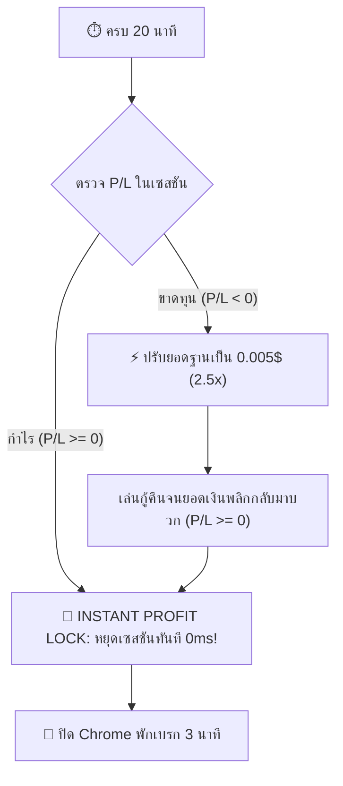

# 📗 HANDBOOK — คู่มือรวม Stake Dice Bot (สำหรับผู้ใช้ + AI ทุกตัว)

> **ยึดโค้ดจริงเป็นความจริงสูงสุด (Single Source of Truth):**  
> `stake_extension/content.js` — Build **`2026.11.13+v2.4.20-api-baseline`** (`@version 2.4.20`)  
> `stake_extension/manifest.json` — Version **`2.4.20`** (Manifest V3 Dual-World: MAIN + ISOLATED + unlimitedStorage)  
> **บัญชีที่รันจริง:** `Profile 4` (`watt29`) เท่านั้น — โหมดบัญชีเดียว  
> **แนวทางปฏิบัติสำหรับ AI:** ให้อ่าน [`AGENTS.md`](AGENTS.md) ควบคู่เสมอ  
> 🛡️ **คู่มือความปลอดภัยหลายบัญชี (Multi-Account SOP):** อ่าน [`MULTI_ACCOUNT_SECURITY_GUIDE.md`](MULTI_ACCOUNT_SECURITY_GUIDE.md)  
> ⚠️ **งานวิจัยความเสี่ยง Multi-Account:** อ่าน [`RISK_RESEARCH.md`](RISK_RESEARCH.md)

---

## 1. ข้อมูลสำคัญสำหรับ AI ที่เข้ามารับช่วงต่อ

1. **สถาปัตยกรรมและกลยุทธ์ปัจจุบัน:**
   - ✅ ใช้สถาปัตยกรรม **Dual-World (MAIN + ISOLATED with Batching Task Queue)** ใน `manifest.json`
   - ✅ สคริปต์หลักรันใน `world: "MAIN"` ยิงไว 0ms และเก็บ State ลง `_st_view_prefs_v2` ใน `window.localStorage`
   - ✅ สคริปต์ `bridge.js` รันใน `world: "ISOLATED"` รับสถิติไปบันทึกลง `chrome.storage.local` ทุก 5 วินาที / 30 ไม้
   - ✅ สลับ Roll Over / Under ผ่าน Network GraphQL Request (`rewriteDiceRollBody`) ไม่คลิกปุ่ม DOM
   - ✅ ใช้สูตร **Martingale +73.12% (×1.7312) ล็อกโอกาสชนะ 68%** เท่านั้น (ห้ามนำ Fibonacci เก่ากลับมาใช้)
   - ✅ สุ่มหน่วงเวลาด้วย **Human Jitter (120–280ms) + พักสายตา 1.8–3.2s** ทุกๆ 35–55 ตา
   - ✅ เฝ้าระวังด้วย **Network Watchdog 15 วินาที** Auto-Reload อัตโนมัติเมื่อเว็บค้าง
   - ✅ **Instant Profit Lock 0ms:** เมื่อครบ 20 นาที ทันทีที่ $P/L \ge 0$ สั่งหยุดล็อกกำไรทันที ไม่ต้องรอไม้ 1 และไม่ต้องรอชนะติด 3 ตา
2. **ไฟล์ `.ps1` ทุกไฟล์:** ต้องบันทึกด้วย **UTF-8 with BOM** เสมอ
3. **กฎการแก้ไขโค้ด (Mandatory SOP):** ทุกครั้งที่แก้โค้ด ต้องรัน `.\tools\backup-version.ps1` และ Bump Version ใน `manifest.json` เสมอ

---

## 2. ข้อมูลการตั้งค่าและการคำนวณ (Core Strategy)

* **โอกาสชนะ (Win Chance):** ล็อกคงที่ **`68%`** (Payout ~`99/68` = **1.4559x**)
* **ยอดฐานปกติ (ไม้ 1):** **`0.00015$`** (USDT)
* **ยอดฐานตอนพยุง (Hold):** **`0.00015$`** — ไม่มี Recovery Boost แล้ว (พยุงด้วยฐานเดิมเมื่อครบ 20 นาทีแล้วยังติดลบ)
* **เมื่อแพ้:** เพิ่มยอด **+73.12%** ต่อไม้ (`mStep++`) ตามสูตร:
  $$\text{ยอดเดิมพัน} = \text{ยอดฐาน} \times 1.7312^{(mStep - 1)}$$
* **เมื่อชนะ:** ชนะติดต่อกันครบ **3 ตา** (`currentStreak >= 3`) ดีดกลับไม้ 1 ทันที
* **รอบเวลา:** เล่นรอบละ **20 นาที** พักเบรกคูลดาวน์ **3 นาที (180 วินาที)**

---

## 3. ลำดับขั้นตอน Instant Profit Lock เมื่อครบ 20 นาที



---

## 4. โครงสร้างไฟล์ในโปรเจกต์

```text
d:\script stake\
├── AGENTS.md                          # กฎสถาปัตยกรรมบังคับสำหรับ AI ทุกตัว
├── README.md                          # รายละเอียดโปรเจกต์และกลยุทธ์
├── START_HERE.md                      # คู่มือเริ่มต้นฉบับย่อ 1 นาที
├── PROJECT_GUIDE.md                   # คู่มือเจาะลึกสถาปัตยกรรมระบบ
├── HANDBOOK.md                        # คู่มือรวมฉบับสมบูรณ์ (ไฟล์นี้)
├── SYSTEM_ARCHITECTURE_SUMMARY.md     # รายงานสรุปผลงานและสถาปัตยกรรมทั้งหมด
├── RISK_RESEARCH.md                   # งานวิจัยความเสี่ยง Multi-Account และบล็อกเชน
├── RULE_OF_72.md                      # คู่มือคณิตศาสตร์การเงิน กฎ 72
├── INTEREST_GUIDE.md                  # คู่มือดอกเบี้ยทบต้นและค่าคงที่ e
├── start-bot.bat                      # ไฟล์คลิกเริ่มทำงานอัตโนมัติ
├── backups\                           # โฟลเดอร์สำรองข้อมูลโค้ดทุกเวอร์ชัน
├── tools\
│   ├── rotate-accounts.ps1            # ตัวควบคุมเซสชัน (UTF-8 BOM + Hard Deadline)
│   ├── backup-version.ps1             # สคริปต์ Snapshot Backup อัตโนมัติ
│   ├── show-summary.ps1               # สคริปต์แสดงรายงานสรุปผลกำไรประจำวัน
│   └── rotate-ledger.csv              # สมุดบัญชีประวัติการเล่นทุกเซสชัน
└── stake_extension\
    ├── manifest.json                  # Manifest V3 (Dual-World, v1.9.9)
    ├── content.js                     # โค้ดบอทหลักฝั่ง MAIN World (v1.9.9)
    ├── bridge.js                      # ตัวรับคิวสถิติฝั่ง ISOLATED World
    ├── background.js                  # Service Worker คุมการปิดแท็บ
    └── AGENTS.md                      # กฎสถาปัตยกรรมในโฟลเดอร์ extension
```

---

## 5. การตรวจสอบและทดสอบระบบ

1. **ตรวจสอบความถูกต้องของ Syntax JavaScript:**
   ```powershell
   node -c stake_extension\content.js
   node -c stake_extension\bridge.js
   ```
2. **ดูรายงานผลกำไรประจำวัน:**
   ```powershell
   powershell -ExecutionPolicy Bypass -File tools\show-summary.ps1
   ```
3. **สำรองข้อมูลเวอร์ชันปัจจุบัน:**
   ```powershell
   powershell -ExecutionPolicy Bypass -File tools\backup-version.ps1
   ```
4. **เริ่มรันระบบ:**
   ดับเบิลคลิก `start-bot.bat`
