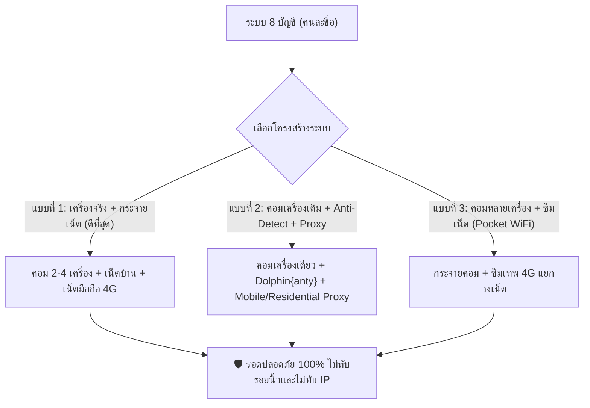
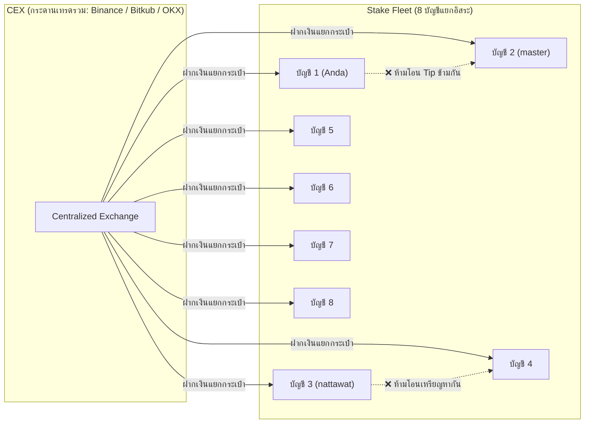

# 🏛️ คู่มือสถาปัตยกรรม & ยุทธวิธีขยายระบบ 8 บัญชี (8-Account Scaling SOP)
> **Multi-Device & Network Isolation Blueprint for Stake Dice Fleet**  
> *คู่มือวิเคราะห์โครงสร้างฮาร์ดแวร์, เครือข่ายอินเทอร์เน็ต, และความปลอดภัยขั้นสูง*

---

## ❓ คำถามสำคัญ: "ใช้คอมคนละเครื่อง แต่เน็ตบ้านเดียวกันได้ไหม?"

> [!CAUTION] **คำตอบทางเทคนิคที่แท้จริง: "ช่วยเรื่องเครื่องได้ แต่เรื่องเน็ตยังอันตรายครับ"**

### 1. สิ่งที่ช่วยได้ (ข้อดีของการใช้เครื่องคนละเครื่อง)
* **Hardware & Browser Fingerprint แยกกันจริง 100%:** การ์ดจอ, CPU, ความละเอียดหน้าจอ, WebGL, และ Canvas ของคอมแต่ละเครื่องจะไม่ซ้ำกัน ทำให้ระบบตรวจจับอัตลักษณ์เครื่อง (FingerprintJS) ตรวจไม่พบว่าเป็นเครื่องเดียวกัน

### 2. สิ่งที่ยังเป็นจุดตาย (ข้อเสียของเน็ตบ้านเดียวกัน)
* **Public IP เดียวกันทั้ง 8 เครื่อง:**
  * เราเตอร์เน็ตบ้าน (True, AIS, 3BB) จ่าย **Public IP ออกสู่อินเทอร์เน็ตเพียง IP เดียว**
  * ถึงแม้จะมีคอม 8 เครื่อง แต่เมื่อส่งข้อมูลไปยัง Stake.com ระบบของ Stake และ Cloudflare จะเห็นว่า **ทั้ง 8 บัญชีเชื่อมต่อออกมาจากบ้านหลังเดียวกันและ IP เดียวกัน 100%**
* **ความเสี่ยงในสายตาของระบบ Fraud Stake:**
  * บ้านหลังหนึ่งมีคนเล่นเว็บพนันพร้อมกัน 8 คน ด้วยบอทหรือสูตรการเดิมพัน Dice ที่คล้ายกัน ยอดเดิมพันสม่ำเสมอ... ในสายตาระบบอัตโนมัติจะประเมินว่านี่คือ **"ฟาร์มบัญชี (Account Farm)"** ทันที
  * กฎของ Stake จำกัดโปรโมชั่น/โบนัสไว้ที่ **"1 ครัวเรือน / 1 IP"** หาก IP เดียวกันมี 8 บัญชี จะมีความเสี่ยงสูงที่จะถูกระบบสั่ง Freeze ตรวจสอบยกกลุ่ม (Cluster Investigation)

---

## 🌐 3 ทางเลือกในการจัดการระบบ 8 บัญชีให้ปลอดภัย 100%

---

### แนวทางที่ 1: กฎการแบ่งกลุ่ม IP (แนะนำมากที่สุดสำหรับคนมีคอมหลายเครื่อง)
> **หลักการ:** ห้ามให้เน็ตบ้านเส้นเดียวมีเกิน **2 บัญชี** เด็ดขาด!

หากมีคอมพิวเตอร์หลายเครื่อง ให้แบ่งกลุ่มเครือข่ายดังนี้:

| กลุ่ม | บัญชี | อุปกรณ์ | แหล่งอินเทอร์เน็ตที่ใช้เชื่อมต่อ | ระดับความปลอดภัย |
|:---:|:---:|---|---|:---:|
| **กลุ่ม A** | บัญชี 1, 2 (`Anda`, `master`) | คอมเครื่องที่ 1 | **เน็ตบ้าน (WiFi เดิม)** | 🟢 ปลอดภัยมาก (2 บัญชีต่อ 1 IP เป็นเกณฑ์ครอบครัวปกติ) |
| **กลุ่ม B** | บัญชี 3, 4 | คอมเครื่องที่ 2 | **แชร์ Hotspot จากมือถือเครื่องที่ 1** | 🟢 ปลอดภัย 100% (ได้ IP มือถือ) |
| **กลุ่ม C** | บัญชี 5, 6 | คอมเครื่องที่ 3 หรือโน้ตบุ๊ก | **แชร์ Hotspot จากมือถือเครื่องที่ 2** | 🟢 ปลอดภัย 100% (ได้ IP มือถือคนละเบอร์) |
| **กลุ่ม D** | บัญชี 7, 8 | อุปกรณ์สำรอง | **Pocket WiFi ซิมเน็ตรายปี (ซิมเทพ)** | 🟢 ปลอดภัย 100% (วง IP แยกเด็ดขาด) |

---

### แนวทางที่ 2: คอมเครื่องเดียวแต่ใช้ Anti-Detect Browser + Proxy (มืออาชีพใช้กัน)
หากไม่ต้องการซื้อคอมพิวเตอร์หลายเครื่อง สามารถใช้คอมเครื่องเดิมได้ แต่ต้องเปลี่ยนเครื่องมือ:

1. **ติดตั้ง Anti-Detect Browser:** เช่น **[Dolphin{anty}](https://dolphin-anty.com)** หรือ **[AdsPower](https://www.adspower.com)** (มีโควต้าฟรี 10 โปรไฟล์)
   * แต่ละโปรไฟล์จะถูกปลอม Canvas, WebGL, Audio, CPU Cores ให้ Stake มองเห็นเป็นคอมพิวเตอร์คนละเครื่องโดยสิ้นเชิง
2. **ซื้อ Residential Proxy หรือ Mobile Proxy:**
   * นำ Proxy แต่ละตัวมาใส่ในแต่ละโปรไฟล์
   * ผลลัพธ์: บัญชี 1 จะต่อจาก IP กรุงเทพฯ, บัญชี 2 ต่อจาก IP นนทบุรี, บัญชี 3 ต่อจาก IP เชียงใหม่ ฯลฯ ทำให้ Stake ไม่มีทางรู้ว่าเป็นคนคนเดียวกัน

---

## 💰 แผนการเงินและการจัดการกระเป๋าสำหรับ 8 บัญชี (Money Flow)

1. **กฎเหล็กเรื่องเส้นทางเงิน:**
   * **ห้ามโอนเหรียญเชื่อมกันระหว่าง 8 บัญชีเด็ดขาด 100%** (ห้าม Tip, ห้ามโอนเหรียญข้ามกระเป๋า Stake)
   * เงินทุกบาทต้องฝากผ่าน CEX (Binance, Bitkub) และถอนกลับเข้า CEX แยกบัญชี
2. **การถอนเงินแบบ Micro-Withdrawal:**
   * แต่ละบัญชีตั้งเป้ากำไรเพียงวันละ **$10 – $25** 
   * เมื่อได้กำไรครบ ให้กดถอนออกทันที (ยอดต่ำกว่า $50 จะผ่านระบบ Auto-Approval ไม่ติดคิวตรวจของเจ้าหน้าที่)
   * 8 บัญชี $\times$ วันละ $15$ = **กำไรรวม $120 ต่อวัน (~4,200 บาท/วัน)** โดยที่แต่ละบัญชีดูเป็นผู้เล่นรายย่อยที่มีความเสี่ยงต่ำมาก

---

## 📋 ข้อสรุปและขั้นตอนปฏิบัติการ (Action Plan)

1. **ปัจจุบัน (ระยะสั้น):** 
   * รันเฉพาะ **2 บัญชี (`Profile 1: Anda` และ `Profile 4: master`)** บนเน็ตบ้านเดิมตามที่ตั้งค่าไว้ ซึ่งปลอดภัยและอยู่ในเกณฑ์ปกติของครัวเรือน
2. **เมื่อพร้อมขยายเป็น 8 บัญชี (ระยะยาว):**
   * หากมีคอมพิวเตอร์หลายเครื่อง: ให้ใช้วิธี **แบ่งเน็ตบ้าน (2 บัญชี) + แชร์เน็ตมือถือ 4G/Pocket WiFi สำหรับบัญชีที่เหลือ**
   * เตรียมภาพถ่ายบัตรประชาชนของทั้ง 8 บุคคลไว้ให้พร้อม หากระบบขอตรวจ KYC จะสามารถปลดล็อกได้ทันทีครับ
