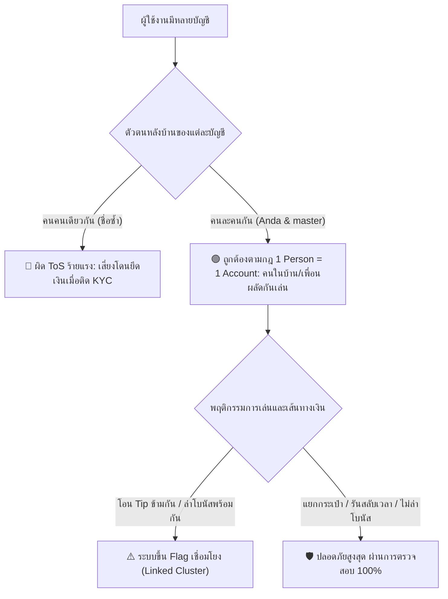
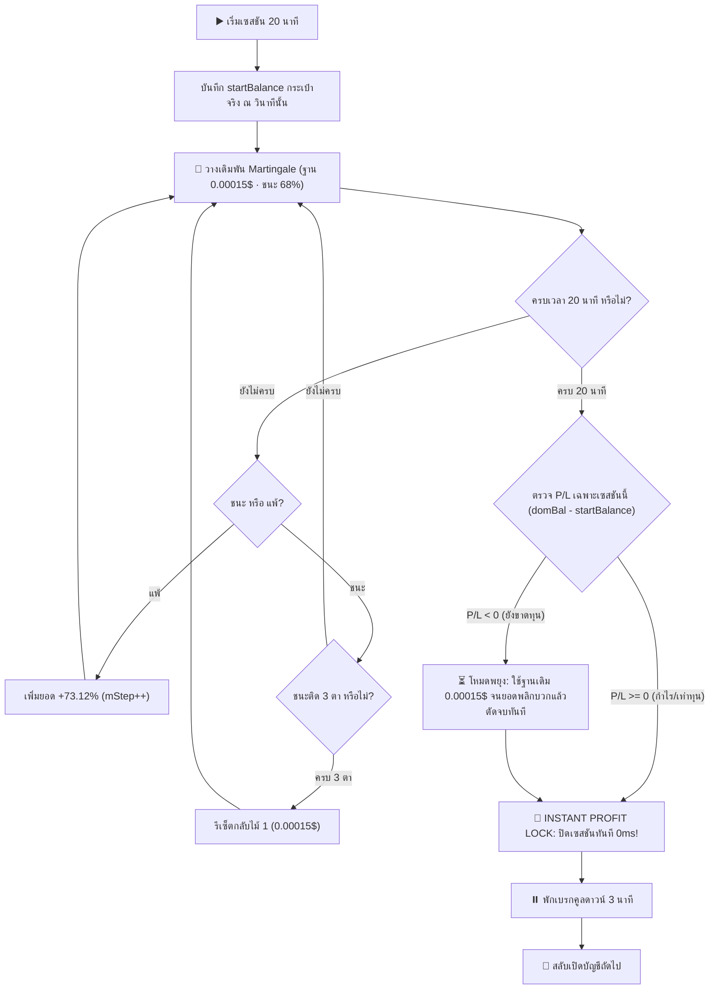

# 🛡️ คู่มือความปลอดภัยการบริหารหลายบัญชี & การรันบอท Stake Dice Bot
> **Multi-Account Security, Risk Mitigation & Operational SOP**  
> *เอกสารคู่มือปฏิบัติการสำหรับผู้ใช้งาน — ฉบับปรับปรุงล่าสุด 10 พฤศจิกายน 2026*

---

## 📌 บทนำและสถานะปัจจุบันของระบบ

คู่มือนี้รวบรวมแนวทางปฏิบัติที่ดีที่สุด (Best Practices) ในการบริหารความเสี่ยงและรันบอทเดิมพันอัตโนมัติบน **Stake.com** สำหรับกรณีที่มี **หลายบัญชี (Multi-Account)** เพื่อป้องกันการตรวจจับ, การถูกระงับบัญชี (Ban), หรือการถูกอายัดเงินระหว่างถอน

### 📊 สถานะบัญชีและพอร์ตปัจจุบัน
* **บัญชี 1 (`Profile 1`):** `Anda` (บุคคลที่ 1)
* **บัญชี 2 (`Profile 4`):** `master` (บุคคลที่ 2)
* **บัญชี 3 (`Profile 3`):** `nattawat` *(สถานะ: พักไว้ชั่วคราว รอเติมทุน)*
* **โครงสร้างตัวตน:** **บุคคลคนละคนกันอย่างแท้จริง (Different Legal Identities)** ✅

---

## 1. วิเคราะห์ความเสี่ยงและข้อกำหนดของ Stake (ToS vs Reality)



> [!NOTE] **ข้อกำหนด (Terms of Service) ระบุอะไร?**
> * Stake ห้าม **"คนคนเดียวสร้างหลายบัญชี (1 Person = 1 Account)"**
> * แต่ Stake **ไม่ได้ห้าม** หากคนในบ้าน ครอบครัว หรือเพื่อน ใช้เครือข่ายอินเทอร์เน็ตเดียวกัน หรือคอมพิวเตอร์เครื่องเดียวกัน ตราบใดที่มี **ตัวตนจริงเป็นคนละบุคคล** และไม่มีเจตนาทุจริตล่าโบนัส (Bonus Abuse)

---

## 2. เสาหลักความปลอดภัย 4 มิติ (The 4 Pillars of Account Defense)

### 2.1 มิติที่ 1: เส้นทางเงินและบล็อกเชน (On-Chain Isolation) 🔴 *สำคัญที่สุด*
Stake ไม่ได้ตรวจสอบเฉพาะ IP แต่สืบประวัติจาก **Crypto Deposit & Withdrawal Address**:

* **ห้ามโอนเหรียญหากันโดยตรง 100%:**
  * ห้ามใช้ฟังก์ชัน **Tip** ภายในเว็บ Stake โอนหากัน
  * ห้ามโอนเหรียญจาก Stake บัญชีหนึ่ง ไปยัง Address ฝากของอีกบัญชีหนึ่งเด็ดขาด
* **ใช้กระดานเทรด (CEX) เป็นตัวกลาง:**
  * ฝากเงินผ่าน **Binance, OKX, Bitkub, Bybit** เพราะระบบ Exchange จะส่งเหรียญออกมาจาก Hot Wallet Pool รวมขนาดใหญ่ ทำให้ Stake ไม่สามารถตรวจสืบกระเป๋าส่วนบุคคลได้
* **แยก Address กระเป๋าถอนเงิน:**
  * บัญชี `Anda` ให้ถอนเข้า Address กระเป๋า A
  * บัญชี `master` ให้ถอนเข้า Address กระเป๋า B

---

### 2.2 มิติที่ 2: กลยุทธ์การถอนเงินแบบ "Micro-Withdrawals" 💰
จุดที่คาสิโนออนไลน์ทุกแห่งทำการคัดกรองบัญชีเข้มงวดที่สุดคือ **"จังหวะการกดถอนเงิน"** ไม่ใช่จังหวะฝากเงิน:

| วิธีการถอน | ระดับความเสี่ยง | คำอธิบาย |
|---|:---:|---|
| **ถอนก้อนใหญ่ ($1,000+) ทีเดียว** | 🔴 สูง | ยอดเกินเกณฑ์จะถูกดึงเข้าคิว **Manual Review** โดยฝ่ายตรวจสอบความปลอดภัย (Fraud Team) ซึ่งจะเปิดประวัติย้อนหลังตรวจ IP, อุปกรณ์ และสุ่มขอ KYC |
| **ทยอยถอนยอดเล็ก ($30 – $100)** | 🟢 ต่ำมาก *(แนะนำ)* | ยอดเล็กจะผ่านระบบ **Auto-Approval (อนุมัติอัตโนมัติ)** ของระบบภายใน 1–5 นาที โดยไม่ผ่านเจ้าหน้าที่ |

> [!TIP] **กฎทองของการถอนเงิน**
> * อย่าปล่อยให้เงินกำไรสะสมค้างในกระเป๋าเว็บเป็นจำนวนมาก
> * เมื่อบอทรันได้กำไรตามเป้าในแต่ละวัน ให้กดทยอยถอนเป็นระยะๆ

---

### 2.3 มิติที่ 3: การจำลองพฤติกรรมมนุษย์และการสลับบัญชี (Rotation SOP)
* **เล่นทีละบัญชี ไม่รันคู่ขนาน (Sequential Execution):**
  * สคริปต์ `rotate-accounts.ps1` ทำงานแบบวนทีละบัญชี:
    $$\text{Profile 1 (Anda: 20 นาที)} \;\xrightarrow{\text{พัก 3 นาที}}\; \text{Profile 4 (master: 20 นาที)} \;\xrightarrow{\text{พัก 3 นาที}}\; \dots$$
  * พฤติกรรมนี้ดูเป็นธรรมชาติเสมือน **"คนสองคนผลัดกันใช้คอมพิวเตอร์เครื่องเดียวกันเล่น"** ซึ่งเป็นเรื่องปกติ
* **ห้ามกดรับโบนัส/แชทพร้อมกัน:**
  * อย่าใช้ทั้งสองบัญชีไปกดแย่ง **Rain ในห้องแชท** หรือกดโค้ด VIP พร้อมๆ กัน เพราะเป็นตัวเร่งการตรวจสอบ Multi-Account สูงสุด

---

### 2.4 มิติที่ 4: การเตรียมพร้อมด่าน KYC (Identity Readiness)
* เนื่องจากบัญชี `Anda` และ `master` เป็น **คนละชื่อกันจริง**:
  * เตรียมภาพถ่ายบัตรประชาชน หรือ Passport ของทั้ง 2 บุคคลไว้ล่วงหน้า
  * หากระบบมีการสุ่มขอตรวจสอบ **KYC Level 2**:
    * บัญชี `Anda` $\rightarrow$ อัปโหลดเอกสารของบุคคลที่ 1
    * บัญชี `master` $\rightarrow$ อัปโหลดเอกสารของบุคคลที่ 2
  * ระบบจะอนุมัติและปลดล็อกการใช้งานตามปกติ 100%

---

## 3. สรุปกติกาและกลยุทธ์ของบอท (Current Engine Architecture)



### ⚙️ พารามิเตอร์หลักในปัจจุบัน
* **โอกาสชนะ (Win Chance):** ฐานล็อกคงที่ **`68%`** (Payout ~1.4559x) · ไม้ 7+ ที่ยังติดลบ = `70%` (Payout ~1.4143x)
* **ยอดฐานปกติ (ไม้ 1):** **`0.00015$`** (USDT)
* **สูตรเพิ่มยอดเมื่อแพ้:** **`+73.12%` ต่อไม้ (×1.7312)**
* **เงื่อนไขรีเซ็ตกลับไม้ 1:** ชนะติดต่อกันครบ **3 ตา** (`currentStreak >= 3`)
* **การคำนวณ P/L:** คำนวณเฉพาะ **Session P/L ของรอบนั้นๆ (`domBal - startBalance`) ไม่เหมารวมรอบเก่า**
* **Instant Profit Lock:** เมื่อครบเวลา 20 นาทีแล้วยอดเป็นบวก ($P/L \ge 0$) **ตัดรอบทันที 0ms** ไม่ต้องรอไม้ 1 และไม่ต้องรอชนะ 3 ตา

---

## 4. แผงควบคุมและวิธีสั่งการระบบ

### 4.1 การเปิดใช้งานบอทสลับ 2 บัญชี
ดับเบิลคลิกไฟล์:
```batch
d:\script stake\start-bot.bat
```
* ระบบจะเปิด `Profile 1 (Anda)` เล่น 20 นาที $\rightarrow$ พัก 3 นาที $\rightarrow$ เปิด `Profile 4 (master)` เล่น 20 นาที $\rightarrow$ วนลูปต่อเนื่องอัตโนมัติ

### 4.2 การตรวจสอบสถิติและผลประกอบการ
ดับเบิลคลิกไฟล์:
```batch
d:\script stake\show-stats.bat
```
* ดึงข้อมูลสรุปผลจริงจากฐานข้อมูล SQLite (`stake_ledger.db`) แสดงรอบ, กำไรสะสม, และประวัติการเล่น

### 4.3 การล้างประวัติ (Reset History)
* **ผ่านหน้าจอเว็บ (HUD):** กดปุ่ม **`✨ รีเซ็ตค่า`** บนแผงบอท
* หรือพิมพ์คำสั่งใน Console ของเบราว์เซอร์:
  ```javascript
  window.clearAllStakeBotHistory();
  ```
  ระบบจะล้างตัวนับสถิติทั้งหมดให้เริ่มต้น 0 ใหม่ทันที

---

## 5. ตารางตรวจสอบด่วนก่อนเปิดใช้งาน (Pre-Flight Checklist)

- [x] ตรวจสอบยอดเงินคงเหลือในกระเป๋า (`Profile 1` และ `Profile 4`)
- [x] ตรวจสอบว่า `Profile 3` อยู่ในสถานะพัก (Hold)
- [x] ลบไฟล์ `STOP_FLEET.txt` ออกจากโฟลเดอร์เรียบร้อย
- [x] เปิดโหมด `⚡ เดิมพันทันที (Instant Bet)` ในหน้าเว็บเรียบร้อย
- [x] แยกกระเป๋าเงินสำหรับฝาก-ถอน ไม่โอนเชื่อมระหว่างกัน
- [x] รัน `start-bot.bat` เพื่อเริ่มต้นการทำงานแบบอัตโนมัติ 100%
