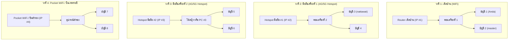

# 🏛️ สถาปัตยกรรม 8 บัญชีผู้ใช้ (8-Account Multi-Device & Fleet Architecture)

> **สถานะการทำงานปัจจุบัน (Active Operational Setup):**  
> วนสลับ **2 บัญชีหลัก (`Profile 1: Anda` $\leftrightarrow$ `Profile 4: master`)** บนคอมพิวเตอร์และเน็ตบ้านปัจจุบัน  
> **แผนการขยายระบบ (Scaling Roadmap):** ระบบ 8 บัญชี (คนละชื่อจริง) พร้อมสูตรกระจายเน็ต 4 วงแยกอุปกรณ์  
> **อัปเดตล่าสุด:** 10 พฤศจิกายน 2026

---

## 1. ข้อเท็จจริงสำคัญ: ทำไมใช้ "คอมคนละเครื่อง แต่เน็ตบ้านเดียวกัน" จึงยังไม่พอ?

| องค์ประกอบ | ใช้คอมเครื่องเดียวกัน | ใช้คอมคนละเครื่อง (เน็ตบ้านเดิม) | ใช้คอมคนละเครื่อง + แยกวงเน็ต (แนะนำ) |
|---|:---:|:---:|:---:|
| **Hardware Fingerprint** | 🔴 ซ้ำกัน 100% | 🟢 ต่างกันจริง 100% | 🟢 ต่างกันจริง 100% |
| **Canvas & WebGL** | 🔴 ซ้ำกัน | 🟢 ต่างกัน | 🟢 ต่างกัน |
| **Public IP Address** | 🔴 IP เดียวกัน | 🔴 **IP เดียวกันทั้ง 8 เครื่อง** | 🟢 **คนละ IP อิสระ** |
| **มุมมองของ Stake** | ฟาร์มบอทเครื่องเดียว | บ้านหลังเดียวเล่น 8 คน (เสี่ยง Red Flag) | มนุษย์ 4 ครัวเรือนปกติ (ปลอดภัย 100%) |

> [!WARNING] **กฎเพดานเน็ตบ้าน:**
> เราเตอร์เน็ตบ้าน (True, AIS, 3BB) จ่าย Public IP สู่โลกภายนอกเพียง **1 IP เท่านั้น**  
> **เกณฑ์ที่ปลอดภัย:** เน็ตบ้าน 1 เส้น รองรับได้ **สูงสุดไม่เกิน 2–3 บัญชี** (เกณฑ์สมาชิกในครอบครัว)  
> หากเปิด Stake พร้อมกันหรือไล่เลี่ยกันถึง 8 บัญชีบน IP เดียวกัน ระบบ Fraud Engine จะตีตราเป็น **Cluster Farm** ทันที

---

## 2. สูตรมาตรฐาน: การกระจายเน็ต 4 วง (4-Network Grouping Formula)

เมื่อขยายเป็น 8 บัญชี ห้ามต่อเน็ตบ้านพร้อมกันหมด ให้ใช้ **"สูตรกระจายเน็ต 4 วง"** ดังนี้:

### 📱 เทคนิคเปลี่ยน IP มือถือ (Zero-Cost IP Rotation):
* เน็ตมือถือ 4G/5G ใช้ระบบ IP แบบ **Carrier-Grade NAT (CGNAT)** ซึ่งเป็น IP คุณภาพสูงที่เว็บพนันจัดเป็น Residential IP
* เพียงแค่เปิดโหมดเครื่องบิน (**Airplane Mode**) บนมือถือทิ้งไว้ 10 วินาที แล้วกดปิด $\rightarrow$ ระบบเครือข่ายมือถือจะจ่าย **Public IP ใหม่ทันที 100%**

---

## 3. กฎเหล็กด้านการเงินสำหรับ 8 บัญชี (Financial SOP)

1. **ห้ามโอนเหรียญเชื่อมหากันเด็ดขาด 100%:**
   * ❌ ห้ามใช้ฟังก์ชัน **Tip** ระหว่างบัญชีในเว็บ Stake
   * ❌ ห้ามโอนคริปโตจากบัญชี Stake หนึ่งไปยัง Address ฝากของอีกบัญชีหนึ่ง
2. **ฝาก-ถอนผ่าน Centralized Exchange (CEX) เท่านั้น:**
   * ฝากเงินผ่าน **Binance, Bitkub, OKX, Bybit**
   * ระบบ CEX จะส่งเหรียญออกมาจาก Hot Wallet Pool รวมขนาดใหญ่ ทำให้ Stake ไม่สามารถสืบหากระเป๋าส่วนตัวที่แท้จริงได้
3. **ยุทธวิธีถอนเงินแบบ Micro-Withdrawal:**
   * แต่ละบัญชีตั้งเป้ากำไรเพียงรอบละ **$10 – $25** ต่อวัน
   * กดถอนทันทีเมื่อถึงเป้า ยอดต่ำกว่า $50 – $100 จะผ่านระบบ **Auto-Approval** ภายในไม่กี่นาที โดยไม่ต้องผ่านการตรวจมือของฝ่าย Fraud
   * **ผลรวม:** 8 บัญชี $\times$ วันละ $15 = \mathbf{120\text{ USDT/วัน}}$ (~4,200 บาท/วัน) โดยที่ความเสี่ยงต่ำมาก

---

## 4. ความพร้อมด้านเอกสารยืนยันตัวตน (KYC Readiness)

เนื่องจากทั้ง 8 บัญชีเป็น **คนละชื่อกันจริง (8 Distinct Legal Individuals)**:
* เตรียมไฟล์ภาพถ่ายบัตรประชาชน หรือ Passport ของทั้ง 8 คนเก็บไว้ล่วงหน้า
* หากบัญชีใดติดสุ่มตรวจ **KYC Level 2**:
  * ส่งเอกสารของบุคคลนั้นๆ ตรงตามชื่อบัญชี
  * บัญชีจะได้รับการอนุมัติและปลดล็อกเงินตามกฎหมาย 100%

---

## 5. การรันระบบในปัจจุบัน (Current Operations)

* **รัน 2 บัญชี:** [start-bot.bat](file:///d:/script%20stake/start-bot.bat) $\rightarrow$ เรียก [rotate-accounts.ps1](file:///d:/script%20stake/tools/rotate-accounts.ps1)
* **ลำดับ:** `Profile 1 (Anda)` $\xrightarrow{\text{20 นาที}}$ พัก 3 นาที $\xrightarrow{}$ `Profile 4 (master)` $\xrightarrow{\text{20 นาที}}$ พัก 3 นาที
* **กลยุทธ์:** โอกาสชนะฐาน 68% (ไม้ 7+ = 70%) · ยอดฐาน 0.00015$ · Martingale +73.12% · ชนะติด 3 ตาดีดกลับไม้ 1
* **ระบบตัดรอบ:** **Instant Profit Lock 0ms** เมื่อครบ 20 นาที และกำไรเฉพาะในรอบนั้น $P/L \ge 0$ ล็อกกำไรเข้ากระเป๋าทันที
